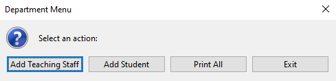
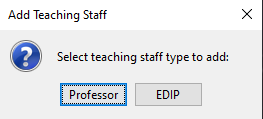
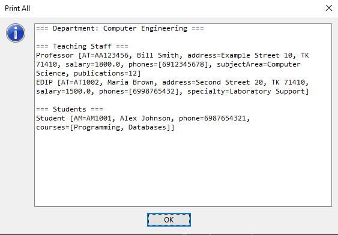
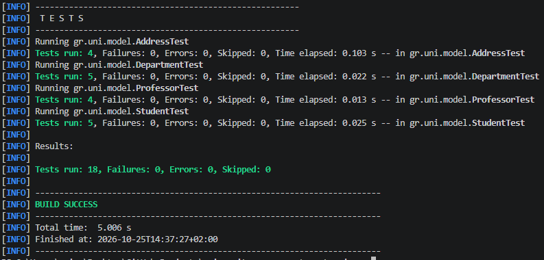

# University Management System - Java

A small university management application developed in **Java** as part of a university programming assignment.

The original project focused on core **Object-Oriented Programming (OOP)** concepts such as inheritance, polymorphism, encapsulation, abstract classes, collections, validation, and a simple Swing-based graphical interface.

The project was later **lightly refactored, tested, and documented for GitHub portfolio presentation**, while preserving the original structure, technologies, and academic scope.

## Features

- Add teaching staff members through a Swing GUI
- Support for two teaching staff types:
  - Professor
  - EDIP
- Add students and their enrolled courses
- Store multiple phone numbers for teaching staff
- Store address information
- Prevent duplicate teaching staff IDs (`AT`)
- Prevent duplicate student IDs (`AM`)
- Input validation for:
  - phone numbers
  - postal codes
  - salaries
  - publication counts
  - names and addresses
- Display all stored teaching staff and students
- Automated unit tests with JUnit 5

## Object-Oriented Design

The project demonstrates several core Java OOP concepts.

### Inheritance

`Professor` and `EDIP` extend the abstract `TeachingStaff` class.

```text
TeachingStaff
├── Professor
└── EDIP
```

### Polymorphism

Teaching staff members are stored using the common `TeachingStaff` type, while subclass-specific implementations are used at runtime through methods such as:

```java
public abstract String role();

protected abstract String extraInfo();
```

### Encapsulation

Fields are kept private and accessed through constructors, getters, setters, and validation methods.

Internal collections are exposed as unmodifiable views.

### Composition

A `TeachingStaff` object contains an `Address` object instead of storing address fields directly inside the class.

## Project Structure

```text
university-management-system-java/
├── assets/
├── src/
│   ├── main/
│   │   └── java/
│   │       └── gr/
│   │           └── uni/
│   │               ├── Main.java
│   │               └── model/
│   │                   ├── Address.java
│   │                   ├── Department.java
│   │                   ├── EDIP.java
│   │                   ├── Professor.java
│   │                   ├── Student.java
│   │                   └── TeachingStaff.java
│   └── test/
│       └── java/
│           └── gr/
│               └── uni/
│                   └── model/
│                       ├── AddressTest.java
│                       ├── DepartmentTest.java
│                       ├── ProfessorTest.java
│                       └── StudentTest.java
├── .gitignore
├── pom.xml
└── README.md
```

## Technologies

- Java 25
- Maven
- Swing / `JOptionPane`
- JUnit 5
- Java Collections Framework

## Application Interface

### Main Menu



The main menu provides access to the core application functions:

- Add Teaching Staff
- Add Student
- Print All
- Exit

### Teaching Staff Selection



Teaching staff can be entered as either a `Professor` or an `EDIP`.

### Stored Data



The application displays professors, EDIP staff members, and students stored in the department.

## Testing

The project includes JUnit 5 tests for the main model and validation logic.

Current automated test coverage includes:

- valid and invalid addresses
- postal code validation
- student creation
- student phone validation
- course validation
- student equality based on `AM`
- professor creation
- negative salary validation
- negative publication count validation
- polymorphic staff role behavior
- adding teaching staff to a department
- duplicate `AT` prevention
- adding students to a department
- duplicate `AM` prevention
- blank department name validation

A total of **18 automated tests** currently pass successfully.



## Build and Test

Compile the project with Maven:

```bash
mvn clean compile
```

Run the automated tests:

```bash
mvn test
```

A successful test run should finish with:

```text
Tests run: 18, Failures: 0, Errors: 0, Skipped: 0

BUILD SUCCESS
```

## Running the Application

Run the `Main` class from your IDE:

```text
src/main/java/gr/uni/Main.java
```

The application opens a Swing-based graphical menu.

## Academic Context

This project was originally developed as a **university Java assignment** focused on:

- class design
- inheritance
- polymorphism
- constructors
- collections
- graphical input
- object-oriented programming principles

For the GitHub portfolio version, the original implementation was preserved while receiving a limited cleanup and refactor, including:

- improved naming and formatting
- removal of unnecessary generated files
- improved validation consistency
- cleaner imports and comments
- Maven project cleanup
- JUnit 5 tests
- GitHub-ready documentation
- application screenshots

The goal of the refactor was to improve readability and maintainability without turning the original academic project into a substantially different application.

## Notes

This is intentionally a small educational project and does not use a database or external application framework.

Data is stored in memory while the application is running.

## Author

Developed as a university programming project and later prepared for GitHub portfolio use.